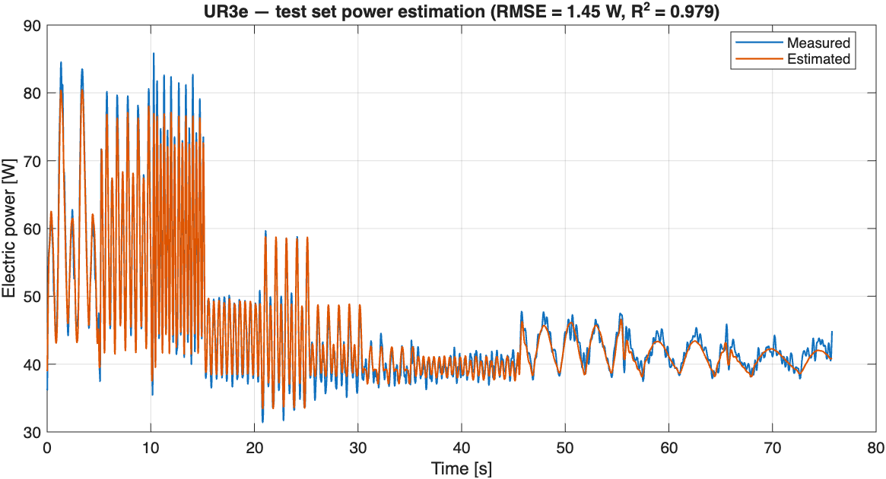
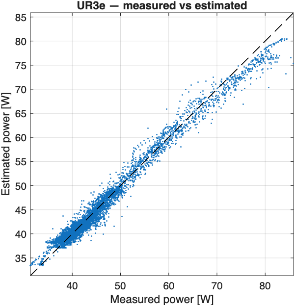
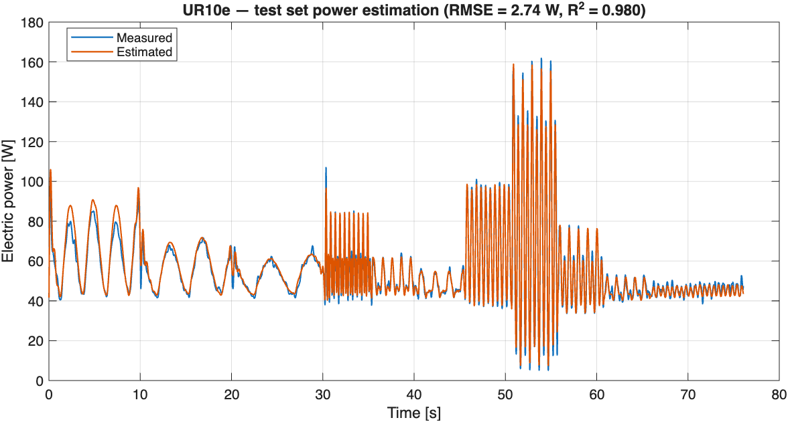
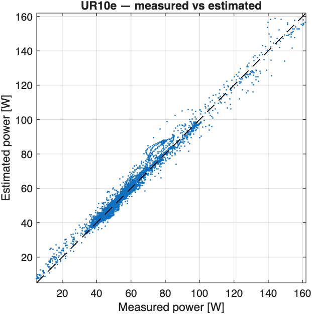
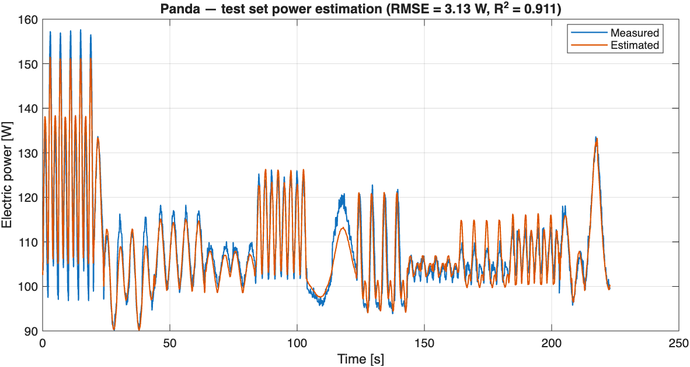
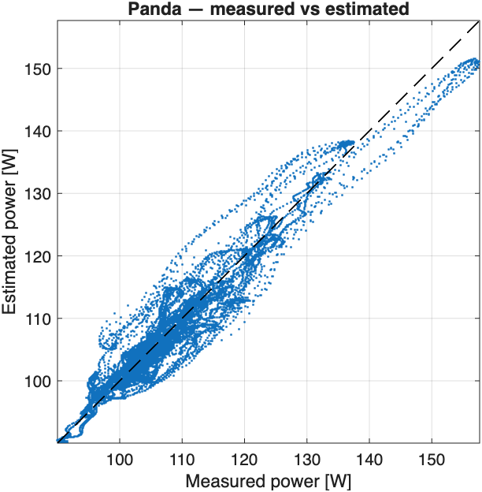
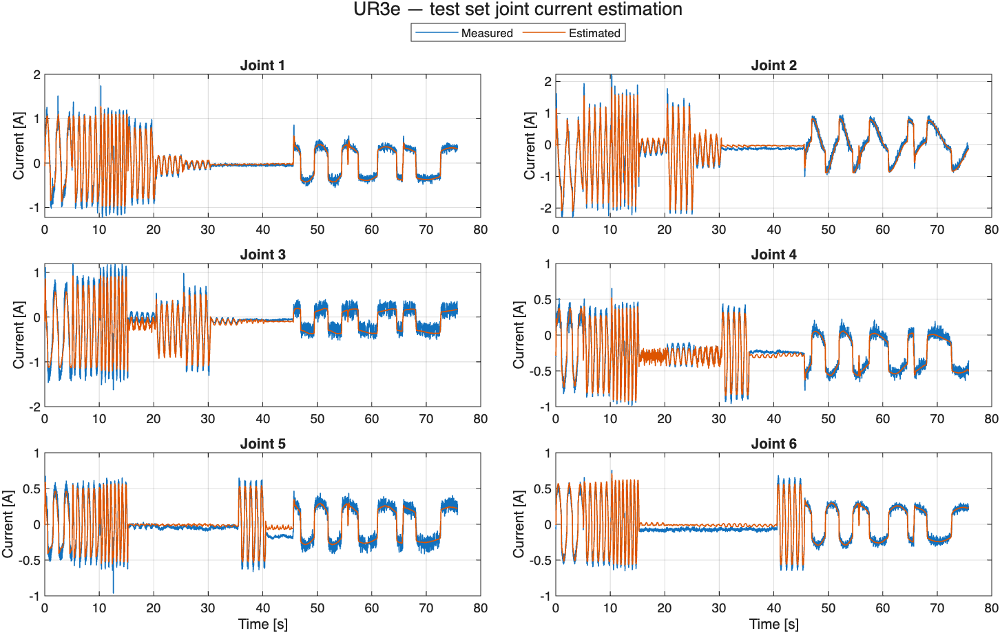
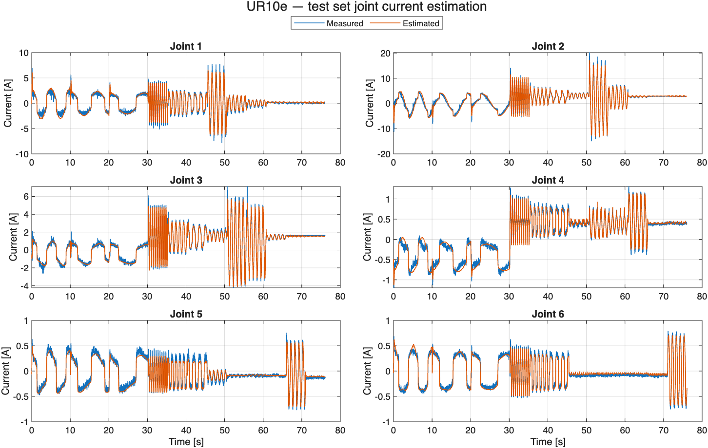
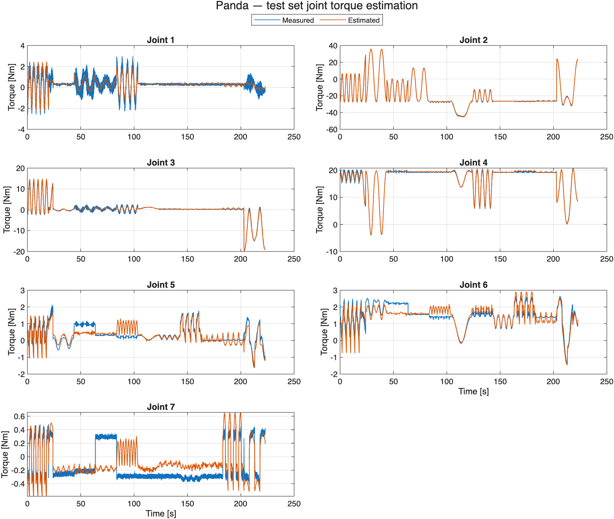

# Benchmark Results

Accuracy of the energy-consumption model on the three datasets provided in this
repository. All models were trained and evaluated with the current version of
the library (three-stage pipeline, see [README](README.md)) on MATLAB R2026a,
June 2026. Each robot is trained on its training dataset and evaluated on its
separate test dataset.

Error metrics: RMSE = root mean squared error, NRMSE = RMSE normalized by the
range of the measured signal, R² = coefficient of determination.

## Datasets

| Robot | Training samples | Training duration | Test samples | Test duration | Measured joint signal |
|---|---:|---:|---:|---:|---|
| UR3e | 105,385 | 1,709 s | 5,997 | 76 s | Currents [A] |
| UR10e | 46,478 | 490 s | 5,997 | 76 s | Currents [A] |
| Franka Panda | 48,950 | 979 s | 11,144 | 223 s | Torques [Nm] |

The Franka Panda raw recordings concatenate 67 executions (episodes) of the
same trajectory. `Raw Data/processingDataFranka.m` splits them at the
time-stamp resets, filters every episode independently (identical low-pass
filtering of velocities, accelerations and power for training and test),
discards episodes that exceed 90 % of the joint velocity limits (3 of 66),
and allocates whole episodes 80/20 to training and test.

## Electric power estimation

### Test set (held-out data)

| Robot | RMSE [W] | NRMSE | R² |
|---|---:|---:|---:|
| UR3e | 1.453 | 0.027 | 0.980 |
| UR10e | 2.737 | 0.017 | 0.980 |
| Franka Panda | 3.130 | 0.046 | 0.911 |

### Training set

| Robot | RMSE [W] | NRMSE | R² |
|---|---:|---:|---:|
| UR3e | 1.427 | 0.012 | 0.975 |
| UR10e | 4.585 | 0.008 | 0.979 |
| Franka Panda | 2.731 | 0.032 | 0.949 |

The close agreement between training and test errors indicates that the models
generalize well within the recorded motion distribution.

### Power tracking on the test sets

**UR3e**





**UR10e**





**Franka Panda**





## Joint current/torque estimation (stage 1, training fit)

### UR3e (currents, A)

| Joint | RMSE [A] | NRMSE | R² |
|---|---:|---:|---:|
| 1 | 0.081 | 0.014 | 0.955 |
| 2 | 0.105 | 0.015 | 0.988 |
| 3 | 0.105 | 0.026 | 0.957 |
| 4 | 0.058 | 0.027 | 0.956 |
| 5 | 0.064 | 0.031 | 0.931 |
| 6 | 0.051 | 0.025 | 0.950 |



### UR10e (currents, A)

| Joint | RMSE [A] | NRMSE | R² |
|---|---:|---:|---:|
| 1 | 0.383 | 0.015 | 0.963 |
| 2 | 0.470 | 0.007 | 0.989 |
| 3 | 0.226 | 0.011 | 0.991 |
| 4 | 0.067 | 0.023 | 0.980 |
| 5 | 0.067 | 0.026 | 0.919 |
| 6 | 0.061 | 0.021 | 0.946 |



### Franka Panda (torques, Nm)

| Joint | RMSE [Nm] | NRMSE | R² |
|---|---:|---:|---:|
| 1 | 0.503 | 0.008 | 0.568 |
| 2 | 0.743 | 0.007 | 0.998 |
| 3 | 0.535 | 0.008 | 0.983 |
| 4 | 0.384 | 0.008 | 0.993 |
| 5 | 0.221 | 0.044 | 0.846 |
| 6 | 0.243 | 0.031 | 0.906 |
| 7 | 0.206 | 0.199 | 0.486 |



The lower R² of Panda joints 1 and 7 reflects measurement noise rather than
model error: most of the time these joints carry almost no load, so the noise
dominates the variance. Their normalized errors (NRMSE 0.008 and 0.199 of the
measured range) and absolute errors remain comparable to the other joints.

## Sigmoid residual correction (stage 3)

The OLS-trained sigmoid residual correction selects its basis size by blocked
5-fold cross-validation, with "no correction" as a candidate. On these three
datasets the stage-2 power residual is noise-dominated (stage 2 already reaches
R² 0.95–0.98) and the correction does not generalize, so the selector disables
it. Example CV table for the UR10e (residual RMSE in W):

| none | 4 basis | 6 basis | 8 basis |
|---:|---:|---:|---:|
| **4.30** | 7.99 | 10.42 | 7.94 |

The stage activates automatically when a dataset exhibits transferable residual
structure (e.g., payload variation or trajectory families not captured by the
torque regressors).

## Pretrained models shipped in this repository

All three shipped model files were generated with the current pipeline and
reproduce the test results above exactly:

| Model file | Trained on |
|---|---|
| `UR3e/parameters_functionModelUR3e.mat` | `UR3e/URRobotData.csv` |
| `UR10e/parameters_functionModelUR10e.mat` | `UR10e/UR10RobotData.csv` |
| `Franka Panda/parameters_functionPandaRobot.mat` | `Franka Panda/FrankaRobotData.csv` |

## Reproducing these results

```matlab
addpath(fullfile(pwd, 'Library'))
cd UR3e;           GeneralModelExample   % trains and tests the UR3e model
cd ../UR10e;       GeneralModelUR10      % trains and tests the UR10e model
cd '../Franka Panda'; GeneralModelFranka % trains and tests the Panda model
```

Each script prints the per-joint and power-model errors reported above and
saves the trained model as `parameters_function<name>.mat`. The figures in
this document are regenerated into `Figures/` by running
[`generate_results_figures.m`](generate_results_figures.m) afterwards.
